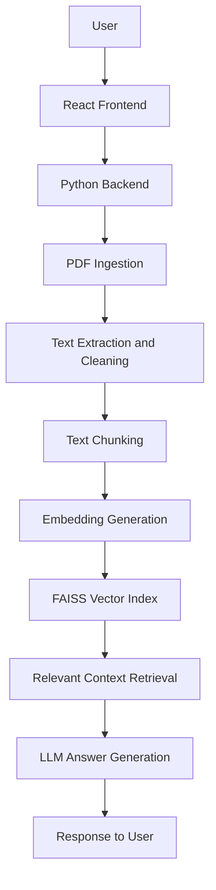

# Enterprise Knowledge Intelligence — Project Guide

## 1. Project Overview

Enterprise Knowledge Intelligence is an AI-powered document question-answering application that allows users to upload PDF documents and ask questions in natural language. It uses Retrieval-Augmented Generation (RAG) to retrieve relevant information and generate context-grounded answers.

## 2. Technology Stack

- ✅ **Frontend:** React
- ✅ **Backend:** Python
- ✅ **Document Processing:** PDF ingestion and text extraction
- ✅ **Text Processing:** Text cleaning and chunking
- ✅ **Embeddings:** Semantic vector representations
- ✅ **Vector Search:** FAISS
- ✅ **AI Architecture:** Retrieval-Augmented Generation (RAG)
- ✅ **Answer Generation:** Large Language Models (LLMs)

## 3. System Architecture



## 4. Core Features

- ✅ **PDF Ingestion:** Process PDF documents for downstream analysis.
- ✅ **Text Cleaning:** Prepare extracted content for retrieval.
- ✅ **Text Chunking:** Divide document text into manageable sections.
- ✅ **Embedding Generation:** Convert text into numerical vector representations.
- ✅ **Semantic Search:** Retrieve relevant document sections using vector similarity.
- ✅ **FAISS Integration:** Support similarity-based retrieval.
- ✅ **RAG Pipeline:** Connect retrieved context with language-model generation.
- ✅ **Question Answering:** Answer natural-language questions about document content.
- ✅ **Full-Stack Application:** Integrate the React frontend with the Python backend.

## 5. Project Structure

```text
enterprise-knowledge-intelligence/
├── backend/
│   └── app/
│       └── services/
│           ├── chunking.py
│           └── cleaning.py
├── frontend/
├── scripts/
│   ├── __init__.py
│   ├── test_ingestion.py
│   └── test_cleaning.py
├── README.md
└── PROJECT_GUIDE.md
```

*This is a representative structure. Additional files may exist in the actual repository.*

## 6. How It Works

### Step 1 — Document Ingestion

- ✅ **PDF Upload:** Accept PDF documents through the application.
- ✅ **Text Extraction:** Extract document text for processing.

### Step 2 — Text Processing

- ✅ **Text Cleaning:** Prepare extracted content for consistent processing.
- ✅ **Text Chunking:** Split text into smaller sections for retrieval.

### Step 3 — Semantic Indexing

- ✅ **Embedding Generation:** Represent document chunks as vectors.
- ✅ **FAISS Indexing:** Organize vectors for similarity-based search.

### Step 4 — Retrieval-Augmented Generation

- ✅ **Question Processing:** Accept a natural-language question.
- ✅ **Context Retrieval:** Retrieve relevant document chunks.
- ✅ **Answer Generation:** Generate an answer using retrieved context.

## 7. Installation and Setup

### Prerequisites

- Python
- Node.js and npm
- Git
- Required model access or API credentials, depending on the configuration

### Step 1 — Clone the Repository

```bash
git clone https://github.com/YOUR_USERNAME/YOUR_REPOSITORY.git
cd enterprise-knowledge-intelligence
```

Replace `YOUR_USERNAME/YOUR_REPOSITORY` with your actual GitHub repository path.

### Step 2 — Set Up the Python Environment

```bash
cd backend
python3 -m venv .venv
source .venv/bin/activate
```

For Windows:

```powershell
.venv\Scripts\activate
```

### Step 3 — Install Dependencies

If the backend contains a `requirements.txt` file:

```bash
pip install -r requirements.txt
```

Use the actual dependency-file location if it differs in your repository.

### Step 4 — Configure Environment Variables

- ✅ **Configuration:** Add the environment variables required by the application.
- ✅ **Credentials:** Keep API keys and secrets out of source control.
- ✅ **Environment File:** Add `.env` to `.gitignore` if the project uses it.

### Step 5 — Start the Backend

Run the command matching your backend entry point. For example, if the application uses FastAPI with `app.main:app`:

```bash
uvicorn app.main:app --reload
```

### Step 6 — Start the Frontend

Open a separate terminal and run:

```bash
cd frontend
npm install
npm run dev
```

Use the scripts defined in the frontend's `package.json`.

## 8. Testing

### Document Ingestion Tests

```bash
python -m scripts.test_ingestion
```

### Text Cleaning Tests

```bash
python -m scripts.test_cleaning
```

- ✅ **Ingestion Checks:** Test document-ingestion behavior using the provided script.
- ✅ **Cleaning Checks:** Test text-cleaning behavior using the provided script.

## 9. Example Usage

### Example Question

```text
What are the main risks described in this document?
```

### Expected Workflow

- ✅ **Input:** Upload a PDF document.
- ✅ **Processing:** Extract, clean, and chunk the document text.
- ✅ **Retrieval:** Search for relevant chunks using vector similarity.
- ✅ **Generation:** Pass retrieved context to the language model.
- ✅ **Output:** Display a natural-language answer.

*The exact answer depends on the uploaded document, retrieval configuration, and selected language model. Source citations should only be claimed if implemented.*

## 10. Security and Reliability

- ✅ **Credential Management:** Keep secrets outside source code.
- ✅ **Input Validation:** Validate uploaded files.
- ✅ **Error Handling:** Handle unsupported or malformed documents.
- ✅ **Data Privacy:** Avoid unnecessary logging of confidential document contents.
- ✅ **Answer Quality:** Evaluate relevance and factual grounding.

## 11. Project Roadmap

### Milestone 1 — Document Ingestion

- ✅ **Completed:** PDF ingestion workflow
- ✅ **Completed:** Text extraction
- ✅ **Completed:** Document-processing foundation

### Milestone 2 — Text Processing

- ✅ **Completed:** Text cleaning service
- ✅ **Completed:** Text chunking service
- ✅ **Completed:** Prepared text for downstream retrieval

### Milestone 3 — Semantic Retrieval and RAG

- ✅ **Completed:** Embedding-based document representation
- ✅ **Completed:** FAISS-based vector retrieval
- ✅ **Completed:** Relevant context retrieval
- ✅ **Completed:** RAG-based answer-generation workflow

### Milestone 4 — Full-Stack Integration

- ✅ **Completed:** React frontend
- ✅ **Completed:** Python backend
- ✅ **Completed:** Frontend and backend integration
- ✅ **Completed:** Document question-answering workflow

### Milestone 5 — Testing and Documentation

- ✅ **Completed:** Document ingestion test script
- ✅ **Completed:** Text cleaning test script
- ✅ **Completed:** Project setup documentation
- ✅ **Completed:** README documentation

## 12. Limitations

- Answer quality depends on document quality, retrieval performance, and the selected language model.
- Scanned PDFs may require OCR support if text cannot be extracted directly.
- Large documents may require additional memory and performance optimization.
- Model availability and API requirements depend on the chosen configuration.

## 13. Future Improvements

- ✅ **Planned:** Improve retrieval quality and ranking.
- ✅ **Planned:** Add more comprehensive evaluation metrics.
- ✅ **Planned:** Expand document-format support.
- ✅ **Planned:** Improve source attribution and answer verification.
- ✅ **Planned:** Add authentication and access controls where required.
- ✅ **Planned:** Improve scalability for larger document collections.

## 14. Demo

- ✅ **Planned:** Add a demonstration video showing PDF upload and question answering.
- ✅ **Planned:** Add the deployed application URL.
- ✅ **Planned:** Add screenshots of the application interface.

## 15. Author

**Praveen Babu**

- **GitHub:** https://github.com/YOUR_USERNAME
- **LinkedIn:** Add your LinkedIn profile URL.
- **Portfolio:** https://portfolio-hazel-gamma-dapikwngs9.vercel.app/

## 16. License

Add an appropriate license file before publicly distributing the project.

---

**Enterprise Knowledge Intelligence** — Transforming enterprise documents into searchable, context-aware knowledge.
